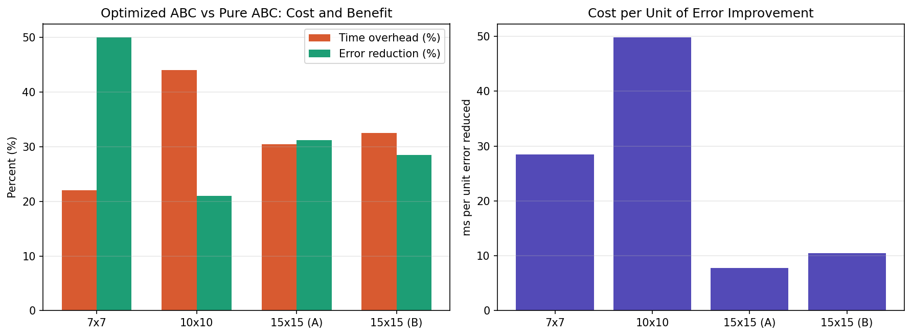

# Nonogram Solver — Artificial Bee Colony

A Java implementation of a nonogram (picross) puzzle solver using the
**Artificial Bee Colony (ABC)** metaheuristic algorithm. The project includes
both a baseline (random bit-flip) implementation and an error-guided
optimized variant, with an empirical benchmark comparing the two across
puzzle sizes.

This started as an unfinished part of my undergraduate thesis and was
completed independently afterward, alongside self-study in distributed
systems and concurrency.

## What Is a Nonogram?

A nonogram is a logic puzzle where a grid must be filled in based on numeric
clues for each row and column, each clue describing the lengths of
consecutive filled blocks. It belongs to the class of **NP-complete**
combinatorial problems, making it a reasonable target for metaheuristic
search rather than exhaustive or purely deductive solving.

## Algorithm

Artificial Bee Colony (ABC) is a swarm-intelligence metaheuristic inspired by
the foraging behavior of honey bees. A population ("colony") of candidate
solutions is maintained and improved over iterations through three roles:

- **Employed bees** exploit a specific solution by generating a nearby
  candidate and keeping it if it improves fitness.
- **Onlooker bees** probabilistically favor better solutions (via
  roulette-wheel selection weighted by fitness) and further refine them.
- **Scout bees** abandon solutions that have not improved for a set number
  of trials, replacing them with a fresh random solution to avoid premature
  convergence.

Fitness is measured as the total mismatch between a candidate grid's row/column
block structure and the puzzle's clues; a fitness of `0` means the puzzle is
solved.

### Two Solver Variants

| Solver | Neighbor generation | Trade-off |
|---|---|---|
| `AbcSolver` | Unguided random bit-flip across the solution vector | Simple, no assumptions, consistent baseline |
| `OptimizedAbcSolver` | Targets the row/column with the highest error before flipping a bit | Faster convergence in most cases, at the cost of extra per-iteration computation |

## Project Structure

```
src/main/java/io/github/ydhekim/nonogram/
├── benchmark/
│   └── BenchmarkRunner.java      # Runs and reports solver comparisons
├── fitness/
│   └── FitnessEvaluator.java     # Computes puzzle-clue mismatch (fitness)
├── model/
│   ├── Puzzle.java               # Immutable puzzle definition (clues)
│   ├── Solution.java             # Candidate solution (flat boolean vector)
│   └── Bee.java                  # A colony member: solution + trial count
├── solver/
│   ├── NonogramSolver.java       # Strategy interface
│   ├── AbstractAbcSolver.java    # Shared ABC algorithm skeleton (Template Method)
│   ├── AbcSolver.java            # Pure random-neighbor implementation
│   └── OptimizedAbcSolver.java   # Error-guided neighbor implementation
├── util/
│   └── SamplePuzzles.java        # Hand-transcribed test puzzles
└── Main.java                     # Entry point / benchmark driver
```

The two solvers share a common algorithm skeleton via
`AbstractAbcSolver` (Template Method pattern); the only thing that differs
between them is how a neighboring candidate solution is generated.

## Requirements

- Java 21
- Maven 3.9+

## Building and Running

```bash
mvn clean package
mvn exec:java
```

Or run `Main.java` directly from your IDE.

## Usage Example

```java
Puzzle puzzle = SamplePuzzles.tenByTen();

NonogramSolver solver = new OptimizedAbcSolver(
        60,     // colony size
        40,     // scout abandonment limit (trials)
        3000,   // max iterations
        0.1     // exploration rate (chance of a fully random move)
);

Solution result = solver.solve(puzzle);
System.out.println("Fitness (0 = solved): " + result.getFitness());
```

## Benchmark Results

The two solvers were compared across four puzzle instances (10 runs each,
same colony size and iteration budget) to measure whether the optimized
variant's extra per-iteration cost is worth its quality improvement.



| Puzzle | Pure ABC (avg error) | Optimized ABC (avg error) | Time overhead | Cost per unit error reduced |
|---|---|---|---|---|
| 7x7 | 5.2 | 2.6 | +22% | 28.5 ms |
| 10x10 | 22.6 | 17.8 | +44% | 49.8 ms |
| 15x15 (A) | 139.1 | 95.7 | +30.5% | 7.8 ms |
| 15x15 (B) | 123.3 | 88.1 | +32.5% | 10.5 ms |

**Key finding:** the optimized solver's efficiency (error reduction per
extra millisecond spent) does **not** scale monotonically with puzzle size.
It is cheapest at 15x15 and most expensive at 10x10, forming a "V" shape
across the three sizes tested. This was verified across two independent
15x15 puzzle instances to rule out it being an artifact of a single puzzle's
structure, and suggests that the effectiveness of error-guided neighbor
selection depends on the density of errors in the candidate solution, not
just on grid size.

This makes the optimized solver clearly worthwhile for small and large
puzzles in this test set, with a less favorable trade-off at the medium size
tested here — a useful reminder that metaheuristic performance is sensitive
to problem instance structure, not just problem size.

## Possible Future Work

- Line-solving preprocessing to pin down deterministically solvable cells
  before search begins
- Incremental fitness evaluation (recomputing only the affected row/column
  after a flip, instead of the whole grid)
- Adaptive mutation rate that decreases over iterations
- Elitism to guarantee the best-found solution is never discarded by the
  scout phase

## Author

Yasin Doğukan Hekim ([@ydhekim](https://github.com/ydhekim))

## License

MIT
