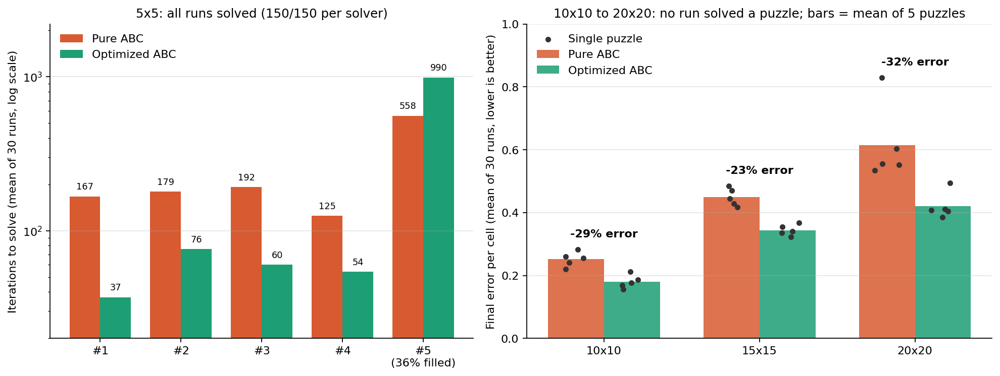

# Nonogram Solver — Artificial Bee Colony

A Java implementation of a nonogram (picross) solver based on the **Artificial Bee Colony (ABC)**
metaheuristic. It ships two interchangeable neighbor-generation strategies and a benchmark harness
that compares them across puzzle sizes from 5x5 to 20x20.

This started as an unfinished part of my undergraduate thesis and was completed afterwards as an
independent project, alongside self-study in distributed systems and concurrency.

## What Is a Nonogram?

A nonogram is a logic puzzle where a grid is filled in from numeric clues for each row and column;
every clue lists the lengths of the consecutive filled blocks in that line. Solving it is
NP-complete, which makes it a reasonable target for metaheuristic search rather than exhaustive
enumeration (a 20x20 grid has 2^400 possible fillings).

## Algorithm

ABC is a swarm-intelligence metaheuristic inspired by the foraging behavior of honey bees. A colony
of candidate solutions ("food sources") is improved over iterations by three kinds of bees:

- **Employed bees** each generate a neighbor of their own solution and keep it if it scores better.
- **Onlooker bees** pick solutions by roulette-wheel selection (better solutions are more likely)
  and try to improve them.
- **Scout bees** replace a solution that has failed to improve for `limit` consecutive trials with a
  fresh random one, which keeps the colony from stagnating.

Fitness is the total mismatch between a candidate grid's row/column blocks and the clues; `0` means
the puzzle is solved.

### Two Solver Variants

Both variants share the same ABC skeleton and differ only in how a neighbor is generated.

| Solver | Neighbor generation | Key parameter |
|---|---|---|
| `AbcSolver` | Every cell flips independently with probability `mutationRate`, so the number of changed cells varies (often zero) | `mutationRate` |
| `OptimizedAbcSolver` | Flips exactly one cell: with probability `explorationRate` a random cell, otherwise a random cell inside the worst-scoring row or column | `explorationRate` |

## Project Structure

```
src/main/java/io/github/ydhekim/nonogram/
├── benchmark/
│   └── BenchmarkRunner.java      # Repeated runs, normalized metrics, one summary line per solver
├── fitness/
│   └── FitnessEvaluator.java     # Clue-mismatch score (0 = solved)
├── model/
│   ├── Puzzle.java               # Puzzle definition (row and column clues)
│   ├── Solution.java             # Candidate solution (flat boolean vector)
│   └── Bee.java                  # A colony member: solution + trial counter
├── solver/
│   ├── NonogramSolver.java       # Strategy interface
│   ├── SolveResult.java          # Best solution + iterations + fitness evaluations
│   ├── AbstractAbcSolver.java    # Shared ABC skeleton (Template Method)
│   ├── AbcSolver.java            # Pure random-mutation variant
│   └── OptimizedAbcSolver.java   # Error-guided single-flip variant
├── util/
│   └── SamplePuzzles.java        # Hand-transcribed test puzzles, five per size
└── Main.java                     # Entry point / benchmark driver
```

## Requirements

- Java 21
- Maven 3.9+

## Building and Running

```bash
mvn clean package
mvn exec:java
```

Or run `Main.java` directly from your IDE.

## Usage

```java
Puzzle puzzle = SamplePuzzles.fifteenByFifteen1();

NonogramSolver solver = new OptimizedAbcSolver(
        80,     // colony size
        40,     // scout abandonment limit (failed trials)
        5000,   // max iterations
        0.7     // exploration rate (probability of a random flip instead of a guided one)
);

SolveResult result = solver.solve(puzzle);
System.out.println("Solved: " + result.solved());
System.out.println("Fitness (0 = solved): " + result.best().getFitness());
System.out.println("Iterations: " + result.iterations());
```

To benchmark a configuration over repeated runs:

```java
BenchmarkRunner runner = new BenchmarkRunner(30);
System.out.println(runner.run("Optimized ABC", puzzle, new OptimizedAbcSolver(80, 40, 5000, 0.7)));
```

```
Optimized ABC  | solved 0/30 (0%) | error/cell 0.368 +/- 0.034 | error 82.7 | iters-to-solve n/a | evals 801992 | time 2221ms
```

## Benchmark Results

**Setup.** Five black-and-white puzzles per size (5x5, 10x10, 15x15, 20x20), hand-transcribed from
[nonograms.org](https://www.nonograms.org) with a fill ratio of roughly 0.42–0.56 (one 5x5 puzzle at
0.36). Each solver ran 30 times per puzzle with the same budget: colony 80, limit 40, 5000
iterations. Pure ABC's `mutationRate` is set to `2 / cells`, about two flipped cells per neighbor
(0.08, 0.02, 0.0089 and 0.005 for 5x5 to 20x20). Optimized ABC uses `explorationRate = 0.7` at every
size. *Error per cell* is the fitness score divided by the number of cells; it is a relative score
for comparing sizes, not the fraction of wrongly filled cells.



| Size | Solved runs | Final error per cell, Pure → Optimized | Time per run, Pure → Optimized |
|---|---|---|---|
| 5x5 | 150/150 → 150/150 | all solved; see iterations in the chart | milliseconds |
| 10x10 | 0/150 → 0/150 | 0.252 → 0.180 (**-29%**) | 1183 → 1118 ms (-5%) |
| 15x15 | 0/150 → 0/150 | 0.449 → 0.344 (**-23%**) | 2465 → 2344 ms (-5%) |
| 20x20 | 0/150 → 0/150 | 0.615 → 0.420 (**-32%**) | 4104 → 3741 ms (-9%) |

**Findings**

- **Optimized ABC ends with 23–32% lower error at 10x10, 15x15 and 20x20**, on the same iteration
  budget and in equal or slightly less wall-clock time. It won on all 15 puzzles; at 20x20 the gap
  is roughly 30 or more standard errors on every puzzle, and the gain shows no consistent trend
  with size.
- **Most of the advantage comes from the move size, not from guidance.** In an ablation on two 10x10
  puzzles, flipping exactly one random cell (`explorationRate = 1.0`) already recovered roughly
  three quarters of the gap to Pure ABC; error-guided targeting added the remaining quarter.
- **The gain depends on puzzle structure.** At 15x15 and 20x20 the puzzles with longer average
  blocks (fewer, chunkier clues per line) were harder for Pure ABC and gave Optimized the largest
  gains; fill ratio explained this worse than block length. This rests on 3 to 5 puzzles per size
  and should be read as an observation, not a result. On the sparsest 5x5 puzzle (36% filled) a
  tuned Pure ABC actually solved faster than Optimized ABC (558 vs 990 iterations), while on the
  other four 5x5 puzzles Optimized needed 2.3–4.5x fewer iterations.
- **No 10x10 or larger puzzle was solved** within 5000 iterations. Longer runs help only some
  puzzles: three times the iterations lowered Optimized ABC's error by 6% to 18% on two 10x10
  puzzles.

**Limitations.** Five puzzles per size, chosen by hand. Runs are unseeded, so repeating a benchmark
shifts per-puzzle means by up to roughly 0.01 error per cell; read smaller differences as noise.
Wall-clock times come from one machine without warm-up, and 5x5 times are too small to be
meaningful, so iterations and evaluation counts are the better measure there.

### Parameter Study

Each parameter was varied one at a time on two 10x10 puzzles (same colony size and budget); the
chosen `explorationRate` was then checked on the other three 10x10 puzzles.

| Parameter | Range tested | Finding |
|---|---|---|
| Pure `mutationRate` | 0.5 to 4 flipped cells per neighbor | U-shaped; best at 1–2 flips, so it is scaled as `2 / cells` for every size |
| Optimized `limit` | 10 to 250 | U-shaped; 40–100 is a flat optimum, 10–20 is clearly worse |
| Optimized `explorationRate` | 0 to 1.0 | Same final error from 0 to 0.7, but 0.7 cuts run time by about a third; 1.0 (no guidance) is worse |
| `maxIterations` | 5000 to 15000 | Puzzle-dependent: error fell 6% to 18% for three times the run time |

Two lessons from tuning. First, a fixed per-cell mutation rate (0.02) silently makes the neighbor
size grow with the grid area; in early runs this likely inflated Optimized ABC's advantage at 15x15
and produced a seemingly non-monotonic trend with size, which disappeared once the rate was scaled.
Second, `explorationRate = 0.7` was chosen for the unsolved large-grid regime. On solvable 5x5
puzzles 0.1 reaches the solution in fewer iterations.

## Future Work

Ordered by what the results above suggest is most valuable:

1. **Line-solving preprocessing.** No puzzle of 10x10 or larger was solved, and error plateaus at
   0.17–0.5 per cell. Fixing the cells that clues alone determine (for example the overlap rule)
   before the search starts would shrink the search space considerably.
2. **Incremental fitness evaluation.** Evaluation dominates run time. Rescoring only the changed
   row and column would make longer budgets and more repetitions cheap, which matters because some
   puzzles are still budget-limited.
3. **Non-strict acceptance.** A bee keeps a neighbor only if it is strictly better, and one 10x10
   puzzle stalled even at three times the iterations. Accepting equal-score neighbors, or
   occasionally slightly worse ones, is a small change worth testing.
4. **Convergence traces.** Recording the best error per iteration would show plateaus directly
   instead of inferring them from budget sweeps.
5. **Fitness variants.** Experiment with scores that smooth the search landscape, for example by
   adding a per-cell mismatch term.
6. **Comparison with other metaheuristics** (genetic algorithm, simulated annealing) under the same
   protocol.

## Author

Yasin Doğukan Hekim ([@ydhekim](https://github.com/ydhekim))

## License

MIT